# Langkah Praktikum 6 - Pemrograman Web

**Nama:** Oan Najmi Zertho  
**NIM/Kelas:** 321510027 / I.25.3A  
**Prodi:** Teknik Informatika  
**Mata Kuliah:** Pemrograman Web  
**Dosen:** Agung Nugroho S.Kom, M.Kom

## Langkah Praktikum - JavaScript DOM dan Event Handling

Praktikum ini membahas cara JavaScript memilih dan mengubah elemen HTML melalui DOM, menangani event pengguna dengan `addEventListener()`, serta membuat validasi form. Latihan 1 sampai 6 dikerjakan pada satu halaman, kemudian dilanjutkan dengan mini project Form Pendaftaran Workshop yang memiliki tiga fitur interaktif.

## Persiapan struktur dokumen HTML

Buat folder kerja `Lab6Web` yang berisi `index.html`, `style.css`, dan `script.js`. Hubungkan file CSS dan JavaScript pada bagian `<head>`.

```html
<!doctype html>
<html lang="id">
	<head>
		<meta charset="UTF-8" />
		<meta name="viewport" content="width=device-width, initial-scale=1.0" />
		<title>Praktikum DOM dan Event</title>
		<link rel="stylesheet" href="style.css" />
		<script src="script.js" defer></script>
	</head>
	<body>
		<h1 id="judul">Latihan DOM</h1>
		<p id="pesan">Belum ada tindakan.</p>
		<button id="tombolAksi" type="button">Klik Saya</button>
	</body>
</html>
```

- `<link rel="stylesheet" href="style.css" />`: Menghubungkan file CSS ke halaman.
- `<script src="script.js" defer></script>`: Menghubungkan file JavaScript. Atribut `defer` membuat script dijalankan setelah HTML selesai diparsing, sehingga elemen yang dipilih sudah tersedia.
- `id="judul"`, `id="pesan"`, `id="tombolAksi"`: Penanda elemen agar dapat dipilih oleh JavaScript.

### Bagian 1 - Manipulasi DOM dan Event

#### 1. Mengubah teks dengan DOM

```javascript
// script.js
const judul = document.getElementById("judul");
const pesan = document.getElementById("pesan");
judul.textContent = "Belajar JavaScript DOM";
pesan.textContent = "Konten berhasil diubah oleh JavaScript.";
```

- `document.getElementById("judul")`: Memilih elemen berdasarkan `id` dan menyimpannya pada konstanta `judul`.
- `textContent`: Mengganti isi teks elemen. Judul berubah menjadi `Belajar JavaScript DOM` dan paragraf berubah menjadi `Konten berhasil diubah oleh JavaScript.`
- `const pesan` hanya dideklarasikan satu kali pada Latihan 1, lalu dipakai kembali pada Latihan 2. Mendeklarasikan `const` dengan nama yang sama dua kali dalam satu file akan menimbulkan error.

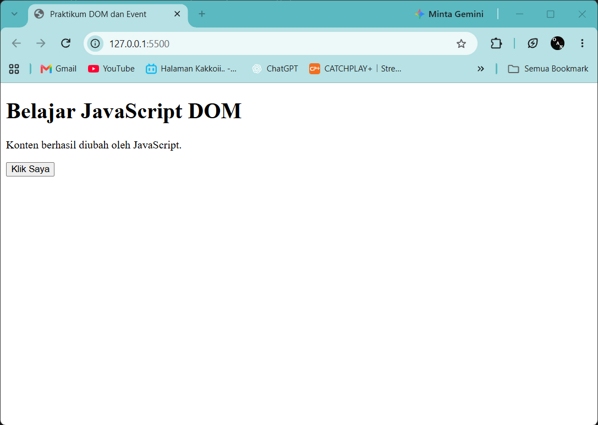

#### 2. Event click

```javascript
const tombol = document.getElementById("tombolAksi");

tombol.addEventListener("click", function () {
	pesan.textContent = "Tombol diklik pada " + new Date().toLocaleTimeString();
});
```

- `addEventListener("click", ...)`: Menghubungkan event `click` pada tombol dengan fungsi yang dijalankan saat tombol diklik.
- `new Date().toLocaleTimeString()`: Mengambil waktu saat ini dalam format jam setempat.
- `pesan.textContent`: Mengganti isi paragraf dengan teks beserta waktu klik, sehingga pesan berubah setiap kali tombol ditekan.

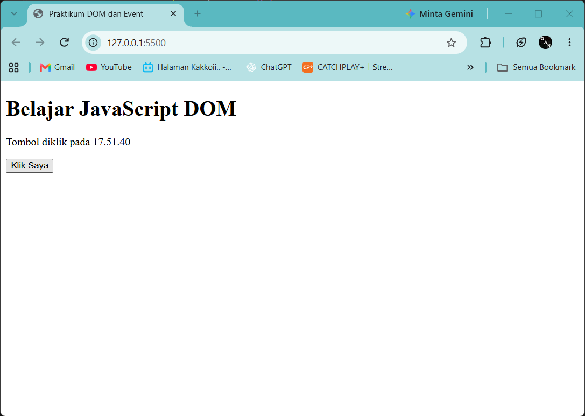

#### 3. Mengubah kelas dan gaya CSS

Tambahkan paragraf dan tombol baru pada `index.html`.

```html
<p id="teksGaya">Contoh Teks</p>
<button id="tombolGaya">Klik Saya</button>
```

Tambahkan aturan berikut pada `style.css`.

```css
.highlight {
	color: #173f75;
	background-color: #e6f1ff;
	border-left: 4px solid #3478c8;
	padding: 12px;
}
.teks-besar {
	font-size: 1.4rem;
}
```

Tambahkan kode berikut pada `script.js`.

```javascript
const tombolGaya = document.getElementById("tombolGaya");
const teksGaya = document.getElementById("teksGaya");
tombolGaya.addEventListener("click", function () {
	teksGaya.classList.toggle("highlight");
	teksGaya.classList.toggle("teks-besar");
});
```

- `.highlight`: Memberi warna teks biru tua, latar biru muda, garis biru di sisi kiri, dan ruang dalam `12px`.
- `.teks-besar`: Memperbesar ukuran huruf menjadi `1.4rem`.
- `classList.toggle("highlight")`: Menambahkan kelas jika belum ada dan menghapusnya jika sudah ada. Satu tombol dapat menyalakan dan mematikan tampilan.
- `classList.add()` hanya menambahkan kelas, `classList.remove()` hanya menghapus kelas, sedangkan `classList.toggle()` bergantian di antara keduanya.

Sebelum tombol diklik:

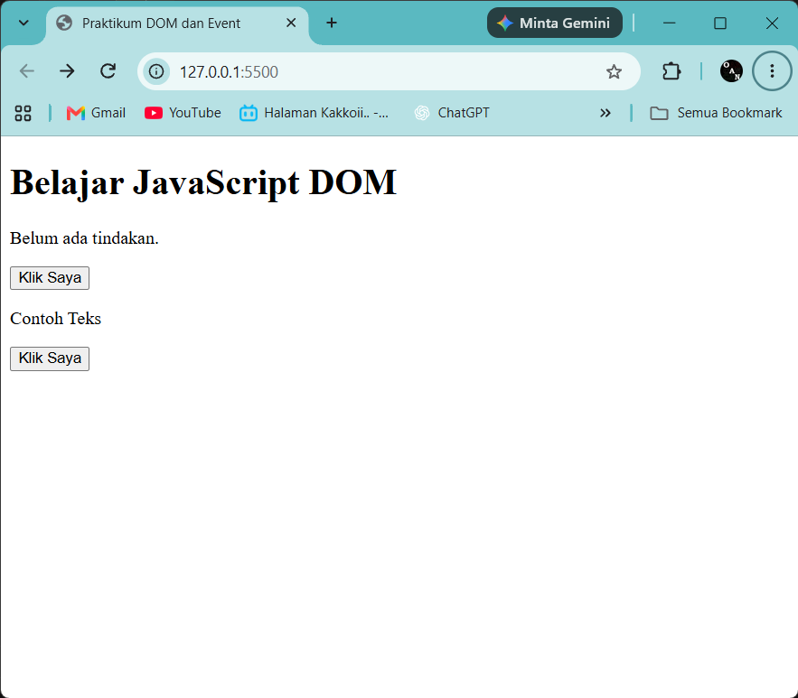

Setelah tombol diklik:

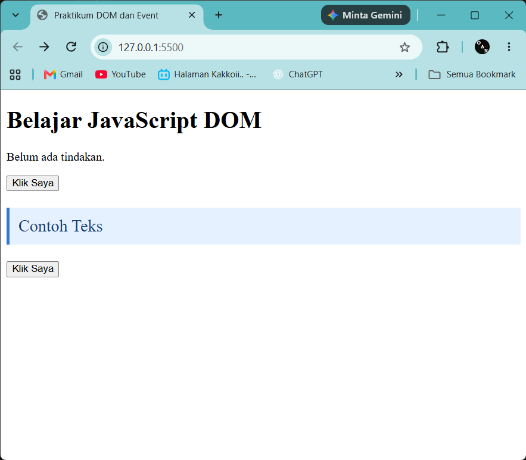

#### 4. Event input dan penghitung karakter

```html
<label for="namaInput">Nama:</label>
<input type="text" id="namaInput" maxlength="40" />
<p>Jumlah karakter: <span id="jumlahKarakter">0</span></p>
```

```javascript
const namaInput = document.getElementById("namaInput");
const jumlahKarakter = document.getElementById("jumlahKarakter");
namaInput.addEventListener("input", function () {
	jumlahKarakter.textContent = namaInput.value.length;
});
```

- `maxlength="40"`: Membatasi input maksimal 40 karakter.
- `<span id="jumlahKarakter">`: Tempat angka jumlah karakter ditampilkan, dengan nilai awal `0`.
- Event `input`: Aktif setiap kali isi kolom berubah, baik saat mengetik, menghapus, maupun menempelkan teks.
- `namaInput.value.length`: Mengambil panjang teks pada kolom lalu menampilkannya pada `jumlahKarakter`.

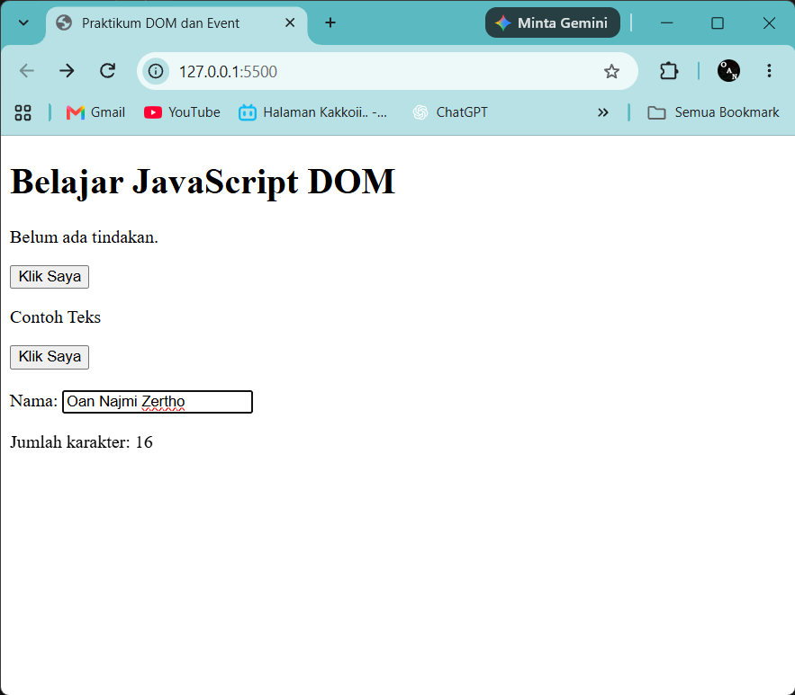

#### 5. Validasi form pendaftaran

```html
<h2>Pendaftaran</h2>
<form id="formPendaftaran" novalidate>
	<label for="nama">Nama lengkap</label>
	<input id="nama" name="nama" type="text" />
	<label for="email">Email</label>
	<input id="email" name="email" type="email" />
	<label for="usia">Usia</label>
	<input id="usia" name="usia" type="number" min="17" max="100" />
	<button type="submit">Daftar</button>
</form>
<p id="pesanForm" aria-live="polite"></p>
```

```javascript
const form = document.getElementById("formPendaftaran");
const pesanForm = document.getElementById("pesanForm");
form.addEventListener("submit", function (event) {
	event.preventDefault();
	const nama = document.getElementById("nama").value.trim();
	const email = document.getElementById("email").value.trim();
	const usiaInput = document.getElementById("usia").value;
	const usia = Number(usiaInput);
	const polaEmail = /^[^\s@]+@[^\s@]+\.[^\s@]+$/;
	if (nama === "") {
		pesanForm.textContent = "Nama wajib diisi.";
	} else if (!polaEmail.test(email)) {
		pesanForm.textContent = "Masukkan email yang valid. (example@gmail.com)";
	} else if (
		usiaInput === "" ||
		!Number.isInteger(usia) ||
		usia < 17 ||
		usia > 100
	) {
		pesanForm.textContent = "Usia harus berupa bilangan bulat 17–100.";
	} else {
		pesanForm.textContent = "Validasi berhasil. Form siap diproses.";
		alert("Validasi berhasil. Form siap diproses.");
		form.reset();
	}
});
```

- `novalidate`: Menonaktifkan validasi bawaan browser agar pemeriksaan dilakukan oleh JavaScript.
- `aria-live="polite"`: Membuat pembaca layar mengumumkan perubahan pesan pada `#pesanForm`.
- `event.preventDefault()`: Mencegah halaman dimuat ulang saat form dikirim, sehingga validasi dapat diselesaikan terlebih dahulu.
- `.trim()`: Membuang spasi di awal dan akhir teks, sehingga isian yang hanya berisi spasi dianggap kosong.
- `polaEmail`: Ekspresi reguler yang memeriksa format email, yaitu teks, tanda `@`, teks, titik, lalu teks.
- `Number.isInteger(usia)`, `usia < 17`, `usia > 100`: Memastikan usia berupa bilangan bulat pada rentang 17 sampai 100.
- `form.reset()`: Mengosongkan form setelah semua input valid.

Pengujian kondisi semua input kosong:

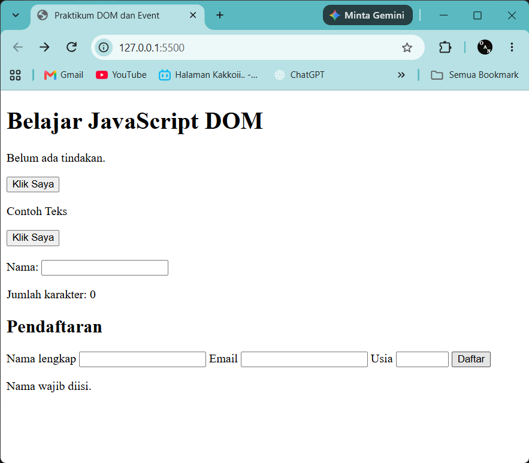

Pengujian kondisi nama kosong:

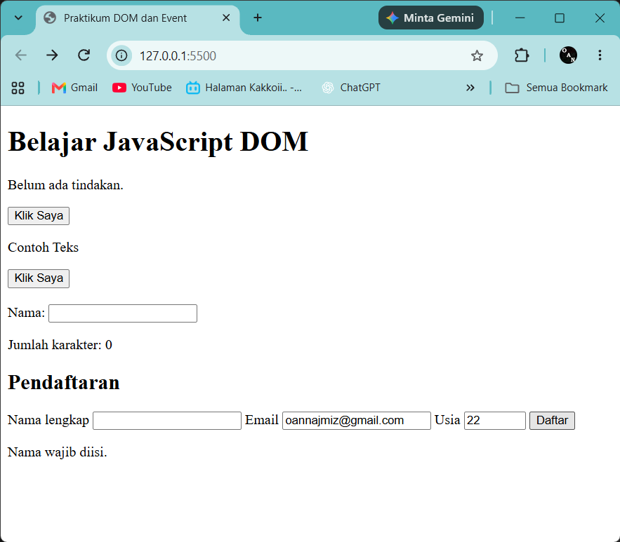

Pengujian kondisi email tidak valid:

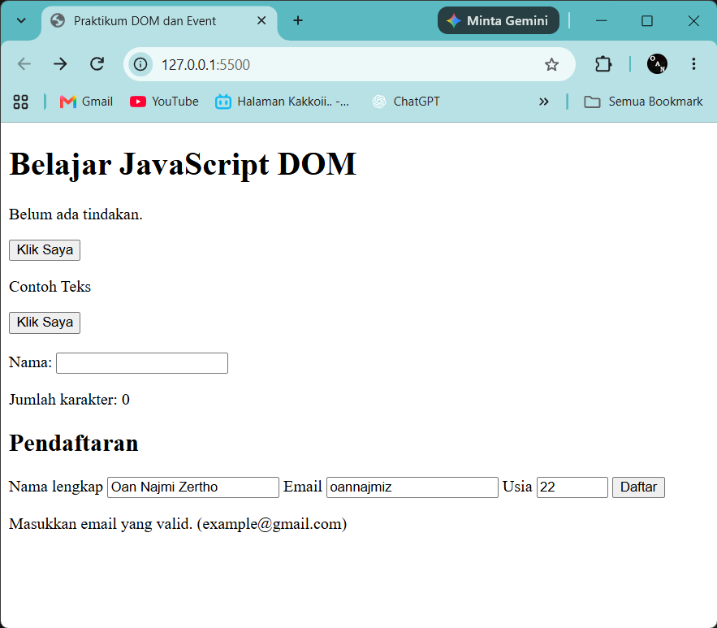

Pengujian kondisi usia tidak sesuai (pada pengujian ini kolom usia dikosongkan):

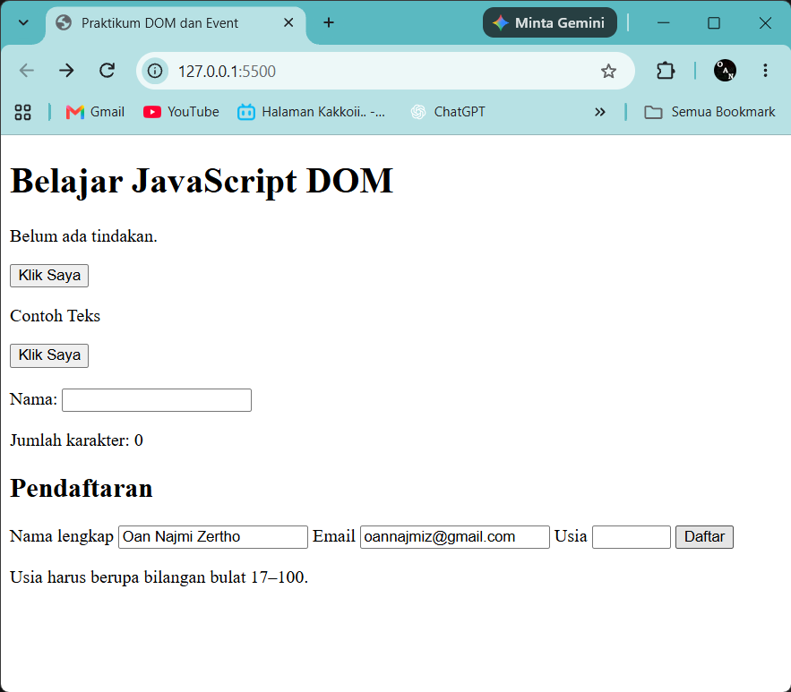

Pengujian kondisi semua input valid:

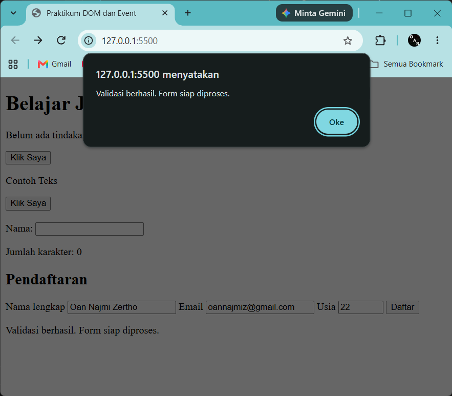

#### 6. Daftar tugas sederhana (To-do List)

```html
<section>
	<h2>Daftar Tugas</h2>
	<label for="inputTugas">Tugas baru</label>
	<input id="inputTugas" type="text" />
	<button id="tambahTugas" type="button">Tambah</button>
	<p id="pesanTugas" aria-live="polite"></p>
	<ul id="daftarTugas"></ul>
</section>
```

```css
.selesai span {
	text-decoration: line-through;
	color: #687386;
}
li {
	margin-bottom: 8px;
}
```

```javascript
const inputTugas = document.getElementById("inputTugas");
const tambahTugas = document.getElementById("tambahTugas");
const daftarTugas = document.getElementById("daftarTugas");
const pesanTugas = document.getElementById("pesanTugas");
tambahTugas.addEventListener("click", function () {
	const teks = inputTugas.value.trim();
	if (teks === "") {
		pesanTugas.textContent = "Tulis tugas terlebih dahulu.";
		return;
	}
	const item = document.createElement("li");
	const label = document.createElement("span");
	const selesai = document.createElement("button");
	label.textContent = teks + " ";
	selesai.type = "button";
	selesai.textContent = "Tandai selesai";
	selesai.addEventListener("click", function () {
		item.classList.toggle("selesai");
		selesai.textContent = item.classList.contains("selesai")
			? "Batalkan selesai"
			: "Tandai selesai";
	});
	item.append(label, selesai);
	daftarTugas.appendChild(item);
	inputTugas.value = "";
	pesanTugas.textContent = "Tugas ditambahkan.";
	inputTugas.focus();
});
```

- `if (teks === "")` dan `return`: Jika kolom kosong, tampil pesan peringatan dan fungsi dihentikan sebelum tugas dibuat.
- `document.createElement(...)`: Membuat elemen `<li>`, `<span>`, dan `<button>` baru secara dinamis.
- `label.textContent = teks + " "`: Teks pengguna dimasukkan dengan `textContent` sehingga ditampilkan sebagai teks biasa, bukan markup HTML.
- `item.append(label, selesai)` dan `daftarTugas.appendChild(item)`: Menyusun teks dan tombol ke dalam item, lalu menambahkan item ke daftar `<ul>`.
- `item.classList.toggle("selesai")`: Menambah atau menghapus kelas `selesai` pada item.
- `.selesai span`: Mencoret teks dan mengubah warnanya menjadi abu pada item yang sudah selesai.
- `classList.contains("selesai")`: Memeriksa apakah kelas sedang aktif untuk menentukan teks tombol, yaitu `Batalkan selesai` atau `Tandai selesai`.
- `inputTugas.value = ""` dan `inputTugas.focus()`: Mengosongkan kolom lalu memfokuskan kembali kursor agar tugas berikutnya langsung dapat diketik.
- `li { margin-bottom: 8px; }`: Memberi jarak antar item daftar.

Pengujian kolom tugas kosong:

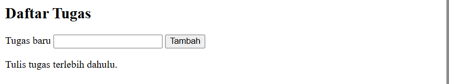

Pengujian menambahkan tugas:

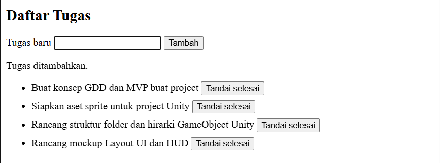

Pengujian menandai tugas selesai:

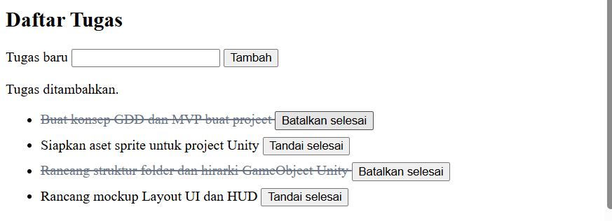

### Bagian 2 - Mini Project Form Pendaftaran Workshop

Mini project dibuat pada folder `mini project` dengan tiga file terpisah, yaitu `index.html`, `style.css`, dan `script.js`. Halaman memiliki tiga fitur interaktif:

1. **Ringkasan input dan penghitung karakter** yang diperbarui langsung saat pengguna mengisi form.
2. **Validasi** nama, email, dan pilihan sesi dengan pesan kesalahan pada setiap kolom.
3. **Pesan sukses dan gagal** yang tampil pada halaman, ditambah tombol **Hapus Input**.

#### 7. Membuat struktur HTML

```html
<!doctype html>
<html lang="id">
	<head>
		<meta charset="UTF-8" />
		<meta name="viewport" content="width=device-width, initial-scale=1.0" />
		<title>Pendaftaran Workshop</title>
		<link rel="stylesheet" href="style.css" />
		<script src="script.js" defer></script>
	</head>
	<body>
		<main class="kartu">
			<h1>Pendaftaran Workshop Web</h1>
			<p class="intro">Isi data berikut untuk mengikuti workshop.</p>

			<form id="formWorkshop" novalidate>
				<div class="grup">
					<label for="nama">Nama lengkap</label>
					<input
						id="nama"
						name="nama"
						type="text"
						maxlength="60"
						autocomplete="name"
					/>
					<p class="error" id="errorNama" aria-live="polite"></p>
				</div>

				<div class="grup">
					<label for="email">Email</label>
					<input id="email" name="email" type="email" autocomplete="email" />
					<p class="error" id="errorEmail" aria-live="polite"></p>
				</div>

				<div class="grup">
					<label for="sesi">Pilihan sesi</label>
					<select id="sesi" name="sesi">
						<option value="">-- Pilih sesi --</option>
						<option value="sesi1">Sesi 1 : Manipulasi DOM</option>
						<option value="sesi2">Sesi 2 : Event Handling</option>
						<option value="sesi3">Sesi 3 : Validasi Form</option>
					</select>
					<p class="error" id="errorSesi" aria-live="polite"></p>
				</div>

				<div class="grup">
					<label for="catatan">Catatan (opsional)</label>
					<textarea
						id="catatan"
						name="catatan"
						rows="4"
						maxlength="150"
					></textarea>
					<p class="hitung">
						Jumlah karakter: <span id="jumlahCatatan">0</span> / 150
					</p>
				</div>

				<div class="aksi">
					<button type="submit" class="tombol-utama">Daftar</button>
					<button type="button" id="tombolReset" class="tombol-sekunder">
						Hapus Input
					</button>
				</div>
			</form>

			<p id="pesanStatus" class="status" aria-live="polite"></p>

			<section class="ringkasan">
				<h2>Ringkasan Input</h2>
				<dl>
					<dt>Nama</dt>
					<dd id="ringkasNama">-</dd>
					<dt>Email</dt>
					<dd id="ringkasEmail">-</dd>
					<dt>Sesi</dt>
					<dd id="ringkasSesi">-</dd>
				</dl>
			</section>
		</main>
	</body>
</html>
```

- `.grup`: Pembungkus untuk satu kelompok label, input, dan pesan kesalahan.
- `<p class="error">`: Tempat pesan kesalahan masing-masing kolom, dengan `aria-live="polite"` agar perubahan pesan terbaca oleh pembaca layar.
- `<select id="sesi">`: Pilihan sesi workshop. Opsi pertama bernilai kosong (`value=""`) sebagai penanda belum ada sesi yang dipilih.
- `<textarea maxlength="150">`: Kolom catatan opsional dengan batas 150 karakter dan penghitung `jumlahCatatan`.
- `type="submit"` pada tombol **Daftar** dan `type="button"` pada **Hapus Input**: Tombol hapus tidak mengirim form, sehingga perilakunya dikendalikan oleh JavaScript.
- `<p id="pesanStatus">`: Tempat pesan sukses atau gagal untuk keseluruhan form.
- `<dl>`, `<dt>`, `<dd>`: Daftar label dan nilai untuk ringkasan input yang diperbarui secara langsung.

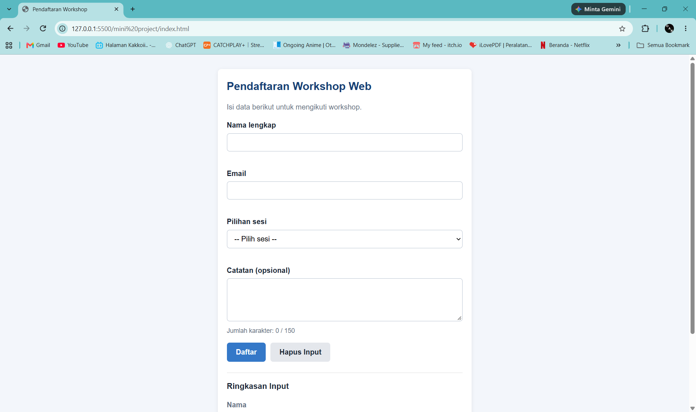

#### 8. Memberikan style dan membuat tampilan responsif

```css
* {
	box-sizing: border-box;
}
body {
	margin: 0;
	padding: 16px;
	background-color: #f3f6fb;
	color: #1f2937;
	font-family: Arial, Helvetica, sans-serif;
	line-height: 1.5;
}
.kartu {
	max-width: 560px;
	margin: 0 auto;
	padding: 20px;
	background-color: #fff;
	border-radius: 8px;
	box-shadow: 0 2px 8px rgba(0, 0, 0, 0.08);
}
h1 {
	margin-top: 0;
	font-size: 1.5rem;
	color: #173f75;
}
.intro {
	color: #687386;
}
.grup {
	margin-bottom: 16px;
}
label {
	display: block;
	margin-bottom: 6px;
	font-weight: bold;
}
input,
select,
textarea {
	width: 100%;
	padding: 10px 12px;
	border: 1px solid #b8c2d0;
	border-radius: 6px;
	font-family: inherit;
	font-size: 1rem;
}
input:focus,
select:focus,
textarea:focus {
	outline: none;
	border-color: #3478c8;
	box-shadow: 0 0 0 3px #e6f1ff;
}
textarea {
	resize: vertical;
}
.invalid {
	border-color: #c0392b;
}
.error {
	min-height: 1.2em;
	margin: 4px 0 0;
	font-size: 0.875rem;
	color: #c0392b;
}
.hitung {
	margin: 4px 0 0;
	font-size: 0.875rem;
	color: #687386;
}
.aksi {
	display: flex;
	flex-direction: column;
	gap: 10px;
}
button {
	padding: 12px 20px;
	border: 0;
	border-radius: 6px;
	font-family: inherit;
	font-size: 1rem;
	font-weight: bold;
	cursor: pointer;
}
.tombol-utama {
	background-color: #3478c8;
	color: #fff;
}
.tombol-utama:hover {
	background-color: #2a64a8;
}
.tombol-sekunder {
	background-color: #e4e7ec;
	color: #1f2937;
}
.tombol-sekunder:hover {
	background-color: #d0d5dd;
}
.status {
	margin: 16px 0 0;
	padding: 0;
	font-weight: bold;
}
.status.sukses {
	padding: 12px;
	color: #14532d;
	background-color: #e7f6ec;
	border-left: 4px solid #2e9e57;
}
.status.gagal {
	padding: 12px;
	color: #7f1d1d;
	background-color: #fdecea;
	border-left: 4px solid #c0392b;
}
.ringkasan {
	margin-top: 24px;
	padding-top: 16px;
	border-top: 1px solid #ddd;
}
.ringkasan h2 {
	margin-top: 0;
	font-size: 1.1rem;
}
dt {
	font-weight: bold;
	color: #687386;
}
dd {
	margin: 0 0 10px;
	overflow-wrap: anywhere;
}

@media (min-width: 480px) {
	body {
		padding: 32px;
	}
	.aksi {
		flex-direction: row;
	}
}
```

- `* { box-sizing: border-box; }`: Menghitung `padding` dan `border` ke dalam lebar elemen, sehingga kolom `width: 100%` tidak melebihi kartu.
- `.kartu`: Membatasi lebar form maksimal `560px`, memusatkannya dengan `margin: 0 auto`, dan memberi latar putih dengan bayangan tipis.
- `input:focus` dan teman-temannya: Memberi tepi dan bayangan biru pada kolom yang sedang aktif.
- `.invalid` dan `.error`: Kelas yang ditambahkan JavaScript untuk memberi tepi merah pada kolom salah dan menampilkan pesan kesalahan berwarna merah.
- `.status.sukses` dan `.status.gagal`: Kotak pesan hijau untuk keberhasilan dan merah untuk kegagalan.
- `.aksi` dengan `flex-direction: column`: Pada layar kecil, tombol tersusun menurun dan selebar form agar mudah ditekan.
- `@media (min-width: 480px)`: Pada layar yang lebih lebar, `flex-direction: row` menyusun tombol berdampingan dan `padding` halaman diperbesar menjadi `32px`.
- `overflow-wrap: anywhere` pada `dd`: Mencegah email atau nama yang panjang melebihi lebar kartu.

Tampilan pada perangkat mobile:

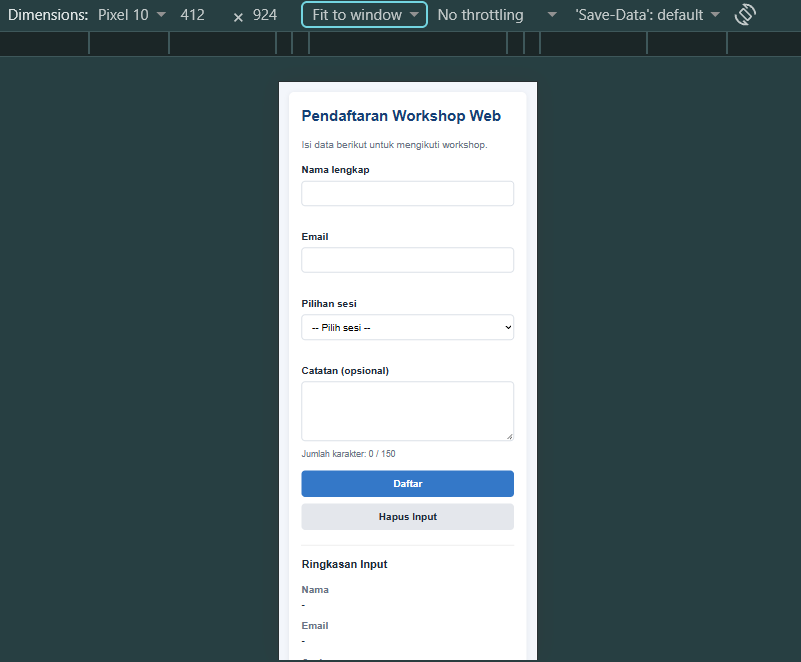

#### 9. Ringkasan input dan penghitung karakter secara langsung

```javascript
// script.js - Mini Project: Form Pendaftaran Workshop

const form = document.getElementById("formWorkshop");
const namaInput = document.getElementById("nama");
const emailInput = document.getElementById("email");
const sesiSelect = document.getElementById("sesi");
const catatanInput = document.getElementById("catatan");
const jumlahCatatan = document.getElementById("jumlahCatatan");
const tombolReset = document.getElementById("tombolReset");
const pesanStatus = document.getElementById("pesanStatus");

const errorNama = document.getElementById("errorNama");
const errorEmail = document.getElementById("errorEmail");
const errorSesi = document.getElementById("errorSesi");

const ringkasNama = document.getElementById("ringkasNama");
const ringkasEmail = document.getElementById("ringkasEmail");
const ringkasSesi = document.getElementById("ringkasSesi");

const polaEmail = /^[^\s@]+@[^\s@]+\.[^\s@]+$/;

function teksSesiTerpilih() {
	if (sesiSelect.value === "") return "";
	return sesiSelect.options[sesiSelect.selectedIndex].textContent;
}

function perbaruiRingkasan() {
	ringkasNama.textContent = namaInput.value.trim() || "-";
	ringkasEmail.textContent = emailInput.value.trim() || "-";
	ringkasSesi.textContent = teksSesiTerpilih() || "-";
	jumlahCatatan.textContent = catatanInput.value.length;
}
```

- Bagian awal menyimpan seluruh elemen yang dibutuhkan ke dalam konstanta agar tidak perlu dipilih berulang kali.
- `teksSesiTerpilih()`: Mengambil teks opsi yang sedang dipilih pada `<select>` melalui `options[selectedIndex]`, dan mengembalikan teks kosong jika belum ada pilihan.
- `perbaruiRingkasan()`: Menyalin isi form ke bagian Ringkasan Input. Operator `||` menampilkan tanda `-` jika isian masih kosong.
- `jumlahCatatan.textContent = catatanInput.value.length`: Memperbarui penghitung karakter catatan.
- Semua teks pengguna dimasukkan dengan `textContent`, bukan `innerHTML`, sehingga tidak ditafsirkan sebagai markup HTML.

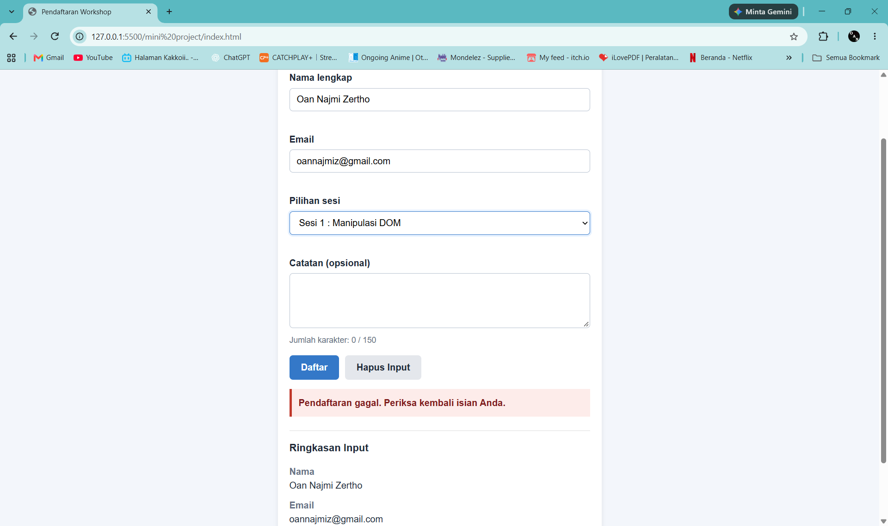

#### 10. Validasi form dan pesan kesalahan

```javascript
function setError(kolom, elemenError, teks) {
	elemenError.textContent = teks;
	kolom.classList.toggle("invalid", teks !== "");
}

function bersihkanError() {
	setError(namaInput, errorNama, "");
	setError(emailInput, errorEmail, "");
	setError(sesiSelect, errorSesi, "");
}

function validasiForm() {
	let kolomPertamaSalah = null;

	if (namaInput.value.trim() === "") {
		setError(namaInput, errorNama, "Nama wajib diisi.");
		kolomPertamaSalah = kolomPertamaSalah || namaInput;
	} else {
		setError(namaInput, errorNama, "");
	}

	if (!polaEmail.test(emailInput.value.trim())) {
		setError(emailInput, errorEmail, "Masukkan email yang valid.");
		kolomPertamaSalah = kolomPertamaSalah || emailInput;
	} else {
		setError(emailInput, errorEmail, "");
	}

	if (sesiSelect.value === "") {
		setError(sesiSelect, errorSesi, "Pilih salah satu sesi workshop.");
		kolomPertamaSalah = kolomPertamaSalah || sesiSelect;
	} else {
		setError(sesiSelect, errorSesi, "");
	}

	return kolomPertamaSalah;
}

function tampilkanStatus(teks, jenis) {
	pesanStatus.textContent = teks;
	pesanStatus.className = teks === "" ? "status" : "status " + jenis;
}
```

- `setError()`: Menampilkan pesan pada kolom tertentu dan menambahkan kelas `invalid` ke kolom tersebut. Parameter kedua `classList.toggle("invalid", teks !== "")` memastikan kelas aktif hanya ketika ada pesan.
- `bersihkanError()`: Menghapus semua pesan kesalahan sekaligus.
- `validasiForm()`: Memeriksa nama kosong, format email, dan sesi yang belum dipilih. Fungsi mengembalikan kolom pertama yang salah (atau `null` jika semua valid) agar kursor dapat diarahkan ke kolom tersebut.
- `tampilkanStatus()`: Mengisi pesan status dan mengatur kelas `sukses` atau `gagal` untuk menentukan warna kotak pesan.

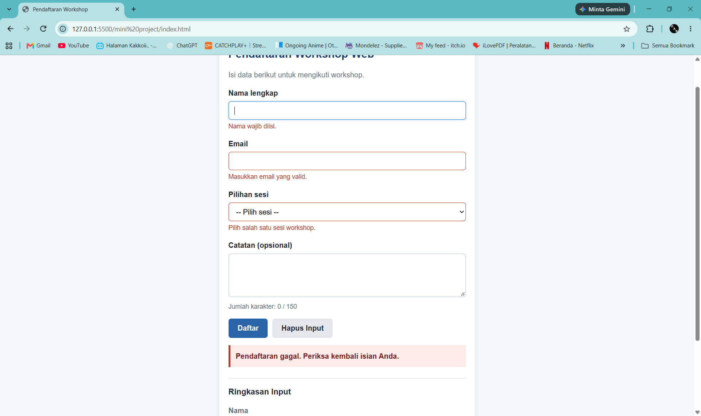

#### 11. Event input, change, submit, dan click

```javascript
namaInput.addEventListener("input", function () {
	perbaruiRingkasan();
	setError(namaInput, errorNama, "");
});
emailInput.addEventListener("input", function () {
	perbaruiRingkasan();
	setError(emailInput, errorEmail, "");
});
catatanInput.addEventListener("input", perbaruiRingkasan);
sesiSelect.addEventListener("change", function () {
	perbaruiRingkasan();
	setError(sesiSelect, errorSesi, "");
});

form.addEventListener("submit", function (event) {
	event.preventDefault();
	const kolomSalah = validasiForm();

	if (kolomSalah) {
		tampilkanStatus("Pendaftaran gagal. Periksa kembali isian Anda.", "gagal");
		kolomSalah.focus();
		return;
	}

	const nama = namaInput.value.trim();
	const sesi = teksSesiTerpilih();
	form.reset();
	perbaruiRingkasan();
	tampilkanStatus(
		"Terima kasih, " + nama + ". Pendaftaran untuk " + sesi + " berhasil.",
		"sukses",
	);
});

tombolReset.addEventListener("click", function () {
	form.reset();
	bersihkanError();
	perbaruiRingkasan();
	tampilkanStatus("Semua input telah dihapus.", "sukses");
	namaInput.focus();
});
```

- Event `input` pada nama, email, dan catatan: Ringkasan diperbarui setiap ada perubahan, dan pesan kesalahan kolom terkait dihapus saat pengguna mulai memperbaiki isian.
- Event `change` pada `<select>`: Ringkasan sesi diperbarui setelah pilihan diganti.
- Event `submit`: `event.preventDefault()` mencegah halaman dimuat ulang. Jika ada kolom yang salah, pesan gagal tampil dan fokus dipindahkan ke kolom tersebut.
- Jika semua valid, nama dan sesi disimpan lebih dulu ke variabel sebelum `form.reset()`, supaya dapat dipakai pada pesan sukses setelah form dikosongkan.
- Event `click` pada **Hapus Input**: Mengosongkan form, menghapus pesan kesalahan, mereset ringkasan, lalu menampilkan pesan bahwa seluruh input telah dihapus.

Ringkasan terisi saat form diisi (sebelum tombol Daftar ditekan) dapat dilihat pada screenshot 7d di atas.

Pesan sukses setelah pendaftaran berhasil:

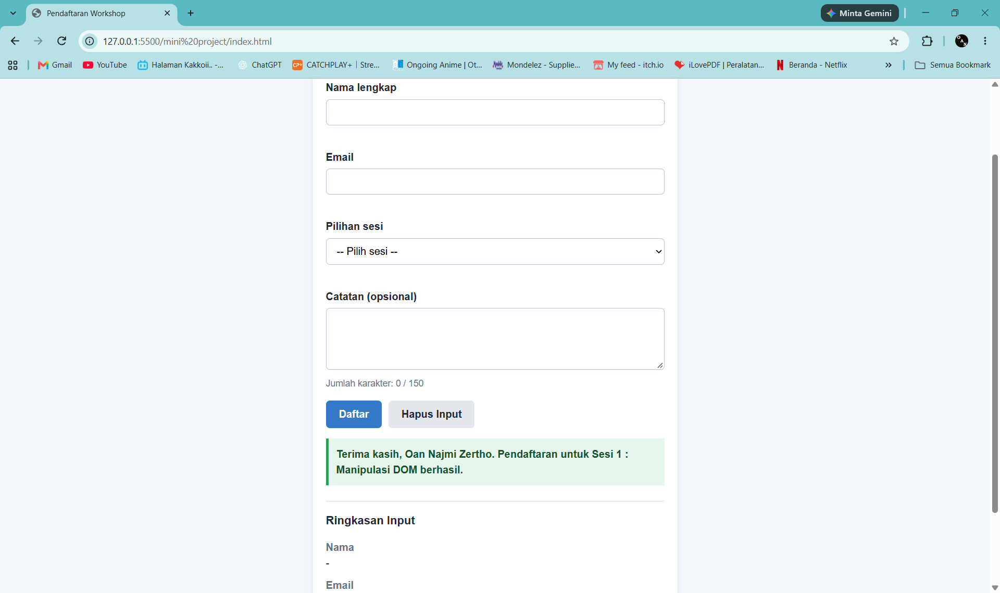

Kondisi setelah tombol Hapus Input diklik:

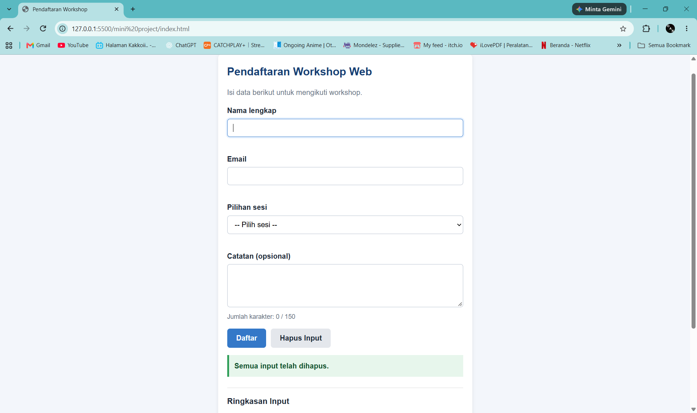
